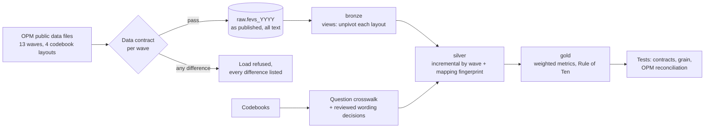

# FEVS Intelligence

**What makes people love, hate, or leave their jobs?**

An analytics-engineering warehouse over every public wave (2012-2024) of OPM's Federal Employee Viewpoint
Survey: 6.76 million completed surveys, 539 million item answers, 13 different file layouts.
It turns them into survey-weighted, trend-safe People Analytics metrics that reconcile with OPM's own
published results.

## Results

**It reproduces OPM's published numbers.** All 67 governmentwide figures in OPM's 2024 Governmentwide
Management Report that this warehouse scores (Employee Engagement Index and its three subindices,
Global Satisfaction Index and its four items, Performance Confidence Index and its four items, Employee
Experience Index, 2020-2024) equal ours once ours is rounded as OPM rounds. A dbt test
(`matches_opm_published_results`) keeps it that way. The five figures it does not score are listed in
that test with the reason (2020 Performance Confidence, see below).

**The Workplace Happiness Paradox (2024).** Job satisfaction and intention to stay are not the same thing:

| Profile (2024, survey-weighted) | Share of workforce | Considering leaving |
|---|---|---|
| Satisfied with job, trusts supervisor, respects senior leaders, workload reasonable | 41.1% | 19.1% |
| Satisfied with job, but none of the other three | 1.2% | 40.3% |
| Not satisfied with job, but all of the other three | 2.5% | 56.4% |
| None of the four | 8.2% | 73.5% |

Even among people satisfied with their job, 23.8% said they were considering leaving within a year
(2013: 20.4%). These are associations in observational survey data, not causes, and "considering
leaving" is a stated intention, not observed turnover.

## Architecture



| Layer | What it holds | Key rule |
|---|---|---|
| raw | Each wave's file exactly as published, plus row number, file SHA-256, contract version | Loaded only if the file matches its versioned contract |
| bronze | One respondent table and one long item-answer view across all 13 layouts | Item columns are read from each raw table at run time; respondent IDs are dropped |
| silver | Typed respondents; every answer linked to its canonical question and scored | Incremental: rebuilds only waves whose file or reviewed mapping changed |
| gold | Question results, OPM indices, stated leave intent, the paradox profiles | Weighted by POSTWT; any group under 10 respondents is suppressed (OPM's Rule of Ten) |

One dbt project runs on DuckDB (local and CI) and on Snowflake (`prod`); SQL that differs between them
goes through adapter dispatch (`macros/reference_version.sql`, `macros/metrics.sql`).

**On Snowflake.** `ingestion/load_snowflake.py` runs the same contract checks, PUTs each file to an
internal stage and COPYs it into `FEVS.RAW`. `dbt build --target prod` then passes all 99 models and
tests, including the OPM reconciliation, and every gold table matches the DuckDB build row for row
(37,416 + 2,837 + 432 + 192 rows; largest numeric difference 7e-8, floating-point summation order).
Setup is one script (`snowflake/setup.sql`): an X-Small warehouse that suspends after 60 s, a
10-credit monthly resource monitor, a `TRANSFORMER` role scoped to one database and one warehouse, and
a key-pair-only service user, so no password exists.

## What the data gets wrong if you trust it naively

These traps are each handled in code and pinned by a test or a reviewed table:

- **Item codes are not questions.** OPM renumbers items (job satisfaction is Q69 in 2012, Q70 in 2024) and
  reuses codes. The crosswalk (`survey_items/`) maps 1,070 item-waves to 271 questions by wording and
  answer scale, never by code.
- **Wording changes.** 44 near-identical wordings each have a written decision in
  `wording_decisions.csv`: `same` (typo), `reworded` (trend kept, break marked), or `different`. The build
  fails on any near-duplicate nobody has reviewed. Examples: "supervisor/team leader" became
  "supervisor" in 2014 (reworded); "the workforce has the job-relevant knowledge" became "my work unit"
  in 2018 (different: a different group is rated); one security item split into cyber and physical in
  2022 (different).
- **Same words, different answers.** The 2021 and 2023 telework questions share their wording but not
  their answer options, so they are separate questions.
- **Leave-intent codes swapped meaning in 2020.** Through 2019, B = "another federal job" and D =
  "other"; from 2020, B = "other" and D = "a job outside government". Codes are decoded per wave through
  `leave_intent_codes.csv`. The 2012 codebook lists five options with no codes for a four-code column, so
  2012 is excluded from leave-intent results rather than guessed.
- **Check-all-that-apply options** carry no parent question in the codebook and repeat across questions,
  so they are never trended.
- **"Do Not Know" is not a rating.** It is kept out of percent-positive denominators, as OPM does.
- **2020's COVID block** (V17/V18) prints item endings without their stems, so it is kept separate. OPM
  trends those items into the 2020 Performance Confidence Index; this warehouse does not, and says so.

## Measured

Measured on an Apple M4 Pro MacBook, DuckDB 2.0.0, dbt-core 1.12.7:

| Step | Time |
|---|---|
| Land all 13 waves (6,760,929 rows) after contract checks | 53.6 s |
| Re-land a wave whose file and contract are unchanged | 0.24 s |
| Draft one wave's contract (profile every column) | 2.1 s (was 44 s with one scan per column) |
| silver item responses, full build (539,108,211 rows) | 51-59 s |
| silver item responses, incremental run with nothing new | 1.4 s |
| silver item responses, rebuild of one changed wave | 4.9 s |
| `dbt build`, all 96 models, seeds and tests, full data | 40-43 s |
| `dbt build` in CI on the committed sample | 5 s |
| Snowflake (X-Small): land all 13 waves (PUT + COPY, mostly upload) | 9 min 41 s |
| Snowflake (X-Small): `dbt build`, all 99 models and tests | 7 min 32 s |
| Snowflake (X-Small): silver incremental run with nothing new | 6.2 s (84 s before waves were chosen ahead of the unpivot) |

## Run it

```bash
python3.12 -m venv .venv && .venv/bin/pip install -r requirements.txt
make test          # unit tests: crosswalk rules and data contracts
# CI path, no download needed: a real ~1,000-row-per-wave sample is committed in fixtures/sample
.venv/bin/python -m ingestion.load_duckdb --sample
DBT_PROFILES_DIR=transform .venv/bin/dbt build --project-dir transform --target ci --exclude tag:full_data
```

The full build needs OPM's public data files in `data/raw/` (downloaded from
[opm.gov/fevs/public-data-file](https://www.opm.gov/fevs/public-data-file/)), unzipped to `data/extracted/<year>/`, then
`make load build`.

## The app

`make app` opens a six-page People Analytics app that reads only the gold export in `app/data/`
(1.5 MB of aggregates; `make export` regenerates it from the warehouse):

| Page | What it does |
|---|---|
| Overview | The paradox headline, six 2024 KPIs with change and 13-year sparklines, one combined trend |
| Happiness Paradox | Build a profile from four answers and see its intention to leave; all 16 profiles ranked; the gap over time |
| Trends | Headline metrics or any of the rated questions, by year, governmentwide or per agency, with wording changes marked |
| Agencies | Agency ranking against governmentwide for any metric and year; one agency's trends against the government |
| Ask the data | An assistant that answers from gold only and cites the table it used |
| Methodology | The OPM reconciliation table, survey method, question mapping, data-quality traps, limitations |

**How the assistant stays honest.** A planner turns a question into one call to a fixed set of tools
(a metric's value or trend, an agency ranking, the paradox, a question search). The default planner is
rule-based; if a local Ollama model is running, it can plan instead, and its plan is validated against
the same tools (anything invalid falls back to the rules). Templates write the answer from the tool's
result, so no model ever writes a number. It declines questions about individuals, attaches a
no-causation note to "why" questions, and answers "turnover" questions as stated intention, saying so.

**Checks.** 44 Python tests, including every page rendering, the assistant's routing and guardrails,
and an independent recomputation: pandas on OPM's raw 2024 file, bypassing dbt, matches the app's
job satisfaction, Army supervisor trust, intention to leave and satisfied-but-leaving figures to 12
decimal places.

## Privacy

Only OPM's public release files are used. Respondent IDs stop at the raw layer (a dbt test checks that no
later layer has them), every published result needs at least 10 respondents, and the app reads only gold
aggregates; suppressed groups are exported with no values and no respondent count.

## Status

Done: crosswalk, contracts, warehouse on DuckDB and Snowflake, tests, CI, the app and the assistant.
Next: S3 landing on AWS and a public demo of the app.
